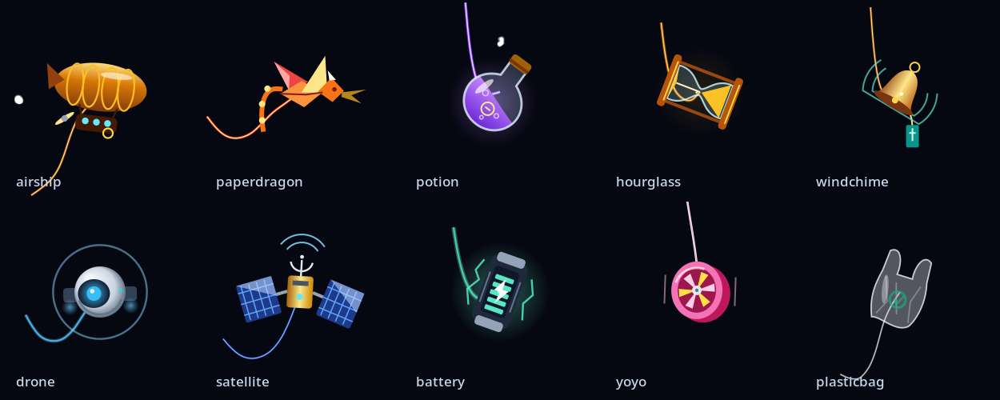

# MousePet

A small, animated companion tethered to your cursor on **Linux + Hyprland**.
Move the mouse to pull the rope, click to trigger a reaction, and switch between
24 built-in companions without restarting the app.

Free and open source under the [MIT license](LICENSE). No account, subscription,
or online service is required.



## Install and run in one line

Run this in a **Bash or Zsh terminal inside your Hyprland session**:

```sh
curl -fsSL https://raw.githubusercontent.com/Y-Workplace/MousePet/main/install.sh | bash && export PATH="$HOME/.local/bin:$PATH" && mousepet run
```

The installer downloads the source, builds it locally, installs it in `~/.local`,
and configures PATH for future Bash, Zsh, and Fish terminals. The `export` in the
one-liner makes it available immediately in the current terminal. After that:

```sh
mousepet run
```

The first install needs an internet connection and a compiler. It can take a few
minutes. On Arch-based systems, the installer installs missing build dependencies
with `sudo pacman`; sudo may ask for your password. The app itself runs as your
normal user. **Read the [installer](install.sh) before executing downloaded code.**

**Tested full setup:** Hyprland **0.56.2**, Arch/CachyOS, x86-64. The companion
plugin uses Hyprland's internal API and must be compiled against headers matching
your running compositor. Other Hyprland versions and distributions are not
claimed to be tested. The installer does not upgrade your compositor.

No manual MousePet environment variables are needed. Hyprland provides
`WAYLAND_DISPLAY`, `XDG_RUNTIME_DIR`, and `HYPRLAND_INSTANCE_SIGNATURE`; MousePet
uses the session values and discovers its installed plugin automatically.
Do not hard-code another machine's display name or instance signature.

### Download and inspect before installing

```sh
git clone https://github.com/Y-Workplace/MousePet.git
cd MousePet
bash install.sh
export PATH="$HOME/.local/bin:$PATH"
mousepet run
```

If dependencies are already installed, use `bash install.sh --no-deps`.
For a custom prefix: `bash install.sh --prefix "$HOME/apps/mousepet"`.
Use `--no-path` if you prefer to manage PATH yourself.

### Prebuilt release

Download the Linux x86-64 archive from [Releases](https://github.com/Y-Workplace/MousePet/releases/latest).
Extract it, open a terminal in the extracted directory, and install without compiling:

```sh
bash install.sh --skip-build --no-deps
export PATH="$HOME/.local/bin:$PATH"
mousepet run
```

The v0.3.0 prebuilt archive targets current Arch/CachyOS with **glibc 2.43+**,
**libstdc++ providing GLIBCXX_3.4.35**, Wayland, Cairo, and LuaJIT. Its plugin targets
**Hyprland 0.56.2 with the matching build hash**. It is not a portable binary for
older distributions. Use the source installer above when these requirements do
not match your system. The release includes SHA-256 checksums.

## Start automatically with Hyprland

The easy way:

```sh
mousepet autostart enable
```

This detects `~/.config/hypr/hyprland.lua` or `hyprland.conf` (respecting
`XDG_CONFIG_HOME`), creates a backup, and adds a managed startup block containing
an absolute executable path. Running it again does not duplicate the entry.
It takes effect at your **next Hyprland login**, and does not reload your desktop.

```sh
mousepet autostart status
mousepet autostart disable
```

For a custom config location:

```sh
mousepet autostart enable --config "$HOME/.config/hypr/my-config.lua"
```

You can also install and configure startup together: `bash install.sh --autostart`.
Use one startup method; remove an older manual MousePet entry if replacing it
with the managed block.

### Manual configuration

For Lua configurations (Hyprland 0.55+):

```lua
hl.on("hyprland.start", function()
    hl.exec_cmd(os.getenv("HOME") .. "/.local/bin/mousepet run")
end)
```

For legacy `.conf` configurations:

```ini
exec-once = ~/.local/bin/mousepet run
```

See the [Hyprland documentation](https://wiki.hypr.land/) for your compositor
version. Starting directly from Hyprland supplies the correct session environment
and avoids relying on the systemd user manager having imported it.

An optional `mousepet.service` is also installed. If choosing systemd instead,
import the current session environment first and use it as your **only** startup
method:

```sh
systemctl --user daemon-reload
systemctl --user import-environment WAYLAND_DISPLAY XDG_RUNTIME_DIR HYPRLAND_INSTANCE_SIGNATURE
systemctl --user start mousepet.service
```

Re-import those variables on each new graphical session. The autostart command is
the recommended approach for a simple Hyprland setup.

## Use MousePet

Keep `mousepet run` in one terminal, then control it from another:

```sh
mousepet list                       # List companions and adjustable parameters
mousepet allay                      # Select a companion by its ID
mousepet pet next                   # Next companion
mousepet pet prev                   # Previous companion
mousepet burst                      # Trigger a reaction manually
mousepet ctl set scale 1.3          # Change visual size
mousepet ctl set ropeLength 80      # Change rope length
mousepet ctl set stiffness 0.5
mousepet ctl set drag 0.92
mousepet ctl blur on                # Enable motion trails
mousepet toggle                    # Toggle visibility
mousepet status                    # JSON status, including plugin connection
mousepet ctl quit                  # Stop the running instance
```

Settings are saved in `~/.config/mousepet/settings.ini`. Press **Ctrl+C** in the
foreground terminal to stop the app. One instance is allowed per Wayland display.
`cursorpet` is an alias for `mousepet`.

### Companions

| IDs | Companions |
| --- | --- |
| `allay`, `ghost`, `firefly`, `fish` | Allay, ghost, firefly, lantern fish |
| `jellyfish`, `balloon`, `hotair`, `airship` | Jellyfish, balloon, hot-air balloon, steampunk airship |
| `star`, `kite`, `paperdragon`, `plasticbag` | Star, kite, paper dragon, flying shopping bag |
| `lantern`, `chineselantern`, `potion`, `hourglass`, `windchime` | Candle lantern, paper lantern, alchemy flask, hourglass, wind chime |
| `ufo`, `ship`, `pirateship`, `drone`, `satellite`, `battery`, `yoyo` | UFO, spaceship, pirate ship, observer drone, satellite, energy cell, yo-yo |

Each has its own movement and click reaction. The installed Lua `bubble` example
adds one extra companion. See [custom accessories](accessories/README.md).

### Plugin controls

```sh
mousepet plugin status
mousepet plugin load
mousepet plugin unload
```

The plugin provides click events, cursor visibility, and precise cursor offsets.
Without it, cursor position can still use Hyprland IPC, but automatic click bursts
and cursor hiding are unavailable. Rebuild/reinstall after a Hyprland upgrade and
restart Hyprland before loading a plugin built against upgraded headers.
[Why matching headers matter](https://wiki.hypr.land/Plugins/Using-Plugins/).

### Optional environment overrides

| Variable | Purpose |
| --- | --- |
| `MOUSEPET_ACCESSORY` | Companion to select at startup, such as `allay` |
| `MOUSEPET_SCALE` | Initial scale, 0.25–4; saved settings can override it |
| `MOUSEPET_CONFIG` | Override the settings file |
| `MOUSEPET_SOCKET` | Override the local control socket |
| `MOUSEPET_PLUGIN` | Explicit path to a matching Hyprland plugin |
| `MOUSEPET_ACCESSORY_DIR` | Extra directory of trusted custom accessories |

These are optional. Legacy `CURSORPET_ACCESSORY` and `CURSORPET_SCALE` are accepted.

## FAQ

### Does it cost anything?

No. MousePet is free, with no subscription, paid features, or required account.
The MIT license permits use, modification, and redistribution; keep its copyright
and license notices. Third-party components retain their own licenses.

### How much RAM does it use?

It depends on the companion, scale, monitor count, and trails. One local sample
on CachyOS + Hyprland 0.56.2 with two monitors reported **14.4 MiB RSS** for the
MousePet process. This is an example, not a guaranteed limit, and excludes memory
used by the plugin inside Hyprland. Build-time memory is much higher.

Measure your own running instance:

```sh
ps -C mousepet -o pid,rss,%cpu,etime,args
```

`RSS` is shown in KiB. CPU use also varies with movement and effects; the project
does not promise a fixed CPU or battery-use budget.

### Does it add mouse delay?

MousePet does not remap, slow down, or capture your mouse input. Its overlay has an
empty input region, so clicks go through to your apps. The plugin observes events
without cancelling them. The companion is rendered at a nominal **60 Hz**, so its
animation can trail the actual cursor by a frame or more when the system is busy.
The rope and character also intentionally lag for the physics effect.

End-to-end input latency has not been benchmarked. Like any background graphics
app, CPU/GPU load can affect system performance on constrained hardware.

### Does it work on Windows, macOS, GNOME, KDE, or X11?

The supported target is Linux running Hyprland on Wayland. There are no supported
Windows, macOS, X11, GNOME, or KDE releases. `--demo` can preview the app on another
Wayland compositor only if it supports the required layer-shell protocols.

### Why is nothing reacting to clicks, or why does hiding not work?

Run `mousepet status` and look for `"pluginConnected": true`. Check
`mousepet plugin status`. If the plugin is missing or incompatible, reinstall
with development headers matching your compositor, then restart the session if
you upgraded Hyprland. Do not run MousePet with sudo.

### Why does the pet disappear when the cursor disappears?

This is intentional: the companion follows cursor visibility, including
`cursor: none` and app requests to hide the cursor. Chromium/Electron cursor
textures are handled even after their backing buffer is released.

### Why does `mousepet` say “command not found” after installation?

Open a new terminal, or run `export PATH="$HOME/.local/bin:$PATH"` in your current
Bash/Zsh terminal. A child installer cannot change its parent shell's environment;
the one-line install command above includes this step. Fish users can run
`fish_add_path ~/.local/bin`.

### Can I customize it? Does it send data anywhere?

Yes: change settings using `mousepet ctl set`, or add trusted Lua/C++ companions.
The app itself uses local Wayland/Unix sockets and shared memory, with no telemetry
or network service. Downloading source and dependencies during installation uses
the network. Custom code can do more; only load accessories you trust.

### How do I update or uninstall?

To update, stop MousePet and unload its plugin before rerunning the installer:

```sh
mousepet ctl quit
mousepet plugin unload
curl -fsSL https://raw.githubusercontent.com/Y-Workplace/MousePet/main/install.sh | bash
mousepet run
```

To uninstall a default-prefix installation:

```sh
mousepet autostart disable
mousepet ctl quit
mousepet plugin unload
rm -f ~/.local/bin/mousepet ~/.local/bin/cursorpet ~/.local/lib/mousepet-hyprland.so
rm -f ~/.config/systemd/user/mousepet.service
rm -rf ~/.local/share/doc/mousepet ~/.local/share/mousepet ~/.local/include/mousepet
systemctl --user daemon-reload
```

If you enabled the optional systemd service, disable it before removing files:
`systemctl --user disable --now mousepet.service`. Your saved settings and custom
accessories are kept. Remove the marked MousePet PATH blocks from your shell
configuration if desired. Adjust paths for custom prefixes/XDG directories.

## Build and test

The app requires a **C++20 compiler**, Make, pkg-config, Wayland client development
files, wayland-protocols, wayland-scanner, Cairo, and LuaJIT. The Hyprland plugin
additionally requires a **C++26-capable compiler**, matching Hyprland development
headers, pixman, libdrm, and the compositor's development dependencies.
Python 3 runs the installer and test tools.

Arch/CachyOS prerequisites (Hyprland must already be installed):

```sh
sudo pacman -S --needed base-devel python wayland wayland-protocols cairo luajit
make -j"$(nproc)"
make test
make sandbox-test
python3 tests/plugin_sandbox_test.py
```

On Debian/Ubuntu, the core can be built with:

```sh
sudo apt install build-essential pkg-config python3 libwayland-dev wayland-protocols libcairo2-dev libluajit-5.1-dev
make -j"$(nproc)" core
make test
```

This does not supply a compatible Hyprland plugin. To install only that core for
preview/testing, use `bash install.sh --core-only --no-deps`.

Nested integration tests require a working outer Wayland session and Hyprland;
otherwise they skip. Headless tests cover physics, orientation, companion
registration, bursts, render bounds, and bridge events. See [CONTRIBUTING.md](CONTRIBUTING.md).

## License and credits

[MIT](LICENSE) for MousePet source and original drawings. See
[THIRD_PARTY_NOTICES.md](THIRD_PARTY_NOTICES.md) for bundled protocol notices and
third-party names. Allay is an independent Minecraft-inspired interpretation;
MousePet is not affiliated with Mojang or Microsoft.

[Source](https://github.com/Y-Workplace/MousePet) ·
[Issues](https://github.com/Y-Workplace/MousePet/issues)
